# 🧠 Second Brain

**A private, AI-powered knowledge base built on Retrieval-Augmented Generation (RAG).**

Upload PDFs, Markdown, text notes and lecture/meeting transcripts — then ask questions in plain English and get answers grounded *only* in your own knowledge, with clickable citations back to the exact page, section or timestamp.

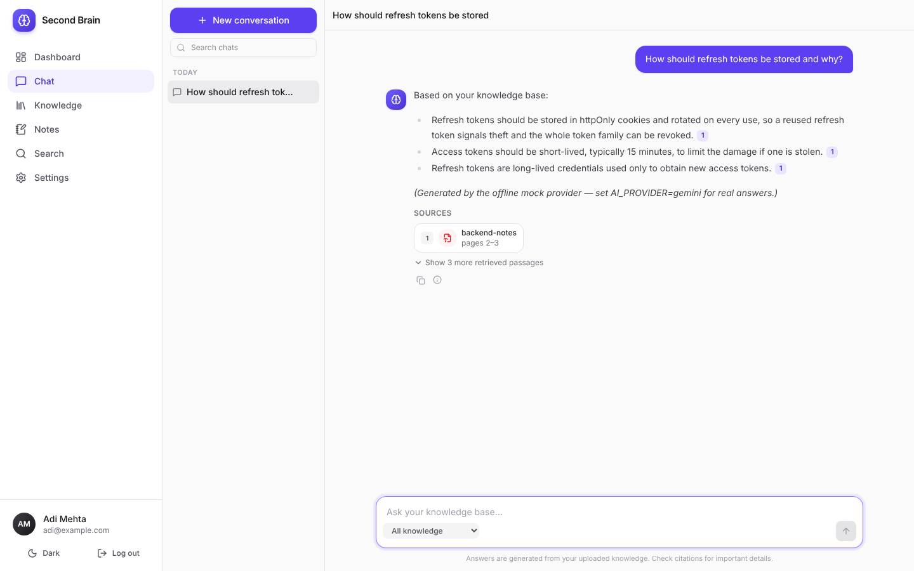

---

## Table of contents

- [Features](#features)
- [Architecture](#architecture)
- [Tech stack](#tech-stack)
- [System design](#system-design)
- [The RAG pipeline](#the-rag-pipeline)
- [Database schema](#database-schema)
- [API documentation](#api-documentation)
- [Environment variables](#environment-variables)
- [Installation & running locally](#installation--running-locally)
- [Testing](#testing)
- [Example queries](#example-queries)
- [Screenshots](#screenshots)
- [Future improvements](#future-improvements)

---

## Features

**Knowledge ingestion**
- Upload **PDF, TXT, Markdown, WebVTT and SRT** files (multi-file, drag & drop, 20 MB limit)
- Page-aware PDF extraction with header/footer removal, hyphenation repair and paragraph re-flow
- Markdown split by heading hierarchy (`Auth > JWT > Refresh tokens`), code blocks preserved
- Transcripts parsed into timestamped passages with speaker labels; timestamped `.txt` files are auto-detected
- **Background processing** through a durable PostgreSQL job queue (`FOR UPDATE SKIP LOCKED`), with retries + exponential backoff
- Live status in the UI: `Queued → Processing → Indexed / Failed`, with retry

**Retrieval & AI**
- **Hybrid search**: pgvector cosine similarity + PostgreSQL full-text search, fused with **Reciprocal Rank Fusion**
- **LLM reranking**: a wide candidate set is scored by a fast model; irrelevant chunks are dropped
- **Conversation-aware RAG**: follow-ups like *"Why is it secure?"* are rewritten into standalone queries
- **Streaming answers** over Server-Sent Events, with a Stop button that cancels the upstream LLM call
- **Citations**: numbered `[1]` markers become clickable chips that open the exact source passage and jump to the PDF page
- Honest "not found" answers when your knowledge base doesn't contain the answer
- **Knowledge graph** of documents & notes linked by embedding similarity and shared tags

**Product**
- Dashboard with stats, recent documents/conversations and quick actions
- Multi-conversation chat history (create, rename, delete, search)
- Markdown notes with tags and live preview, optionally embedded into the knowledge base
- Semantic / keyword / hybrid search page with highlighted snippets
- Document viewer: original file preview + every indexed chunk
- Dark/light/system theme, responsive down to mobile, toasts, skeletons, empty & error states

**Security**
- bcrypt (12 rounds) password hashing, timing-safe login, generic auth errors
- JWT in an **httpOnly, SameSite** cookie (Bearer header also supported for API clients)
- **Tenant isolation**: every query is scoped by `user_id`; other users' ids return `404`, never `403`
- zod validation on every input, parameterised SQL everywhere, Helmet, CORS allow-list, rate limiting
- Upload hardening: extension + MIME allow-list, PDF magic-byte check, binary detection, random server-side filenames, path-traversal guard, text files served as `text/plain` only
- Secrets only in environment variables; API keys never reach the browser

---

## Architecture

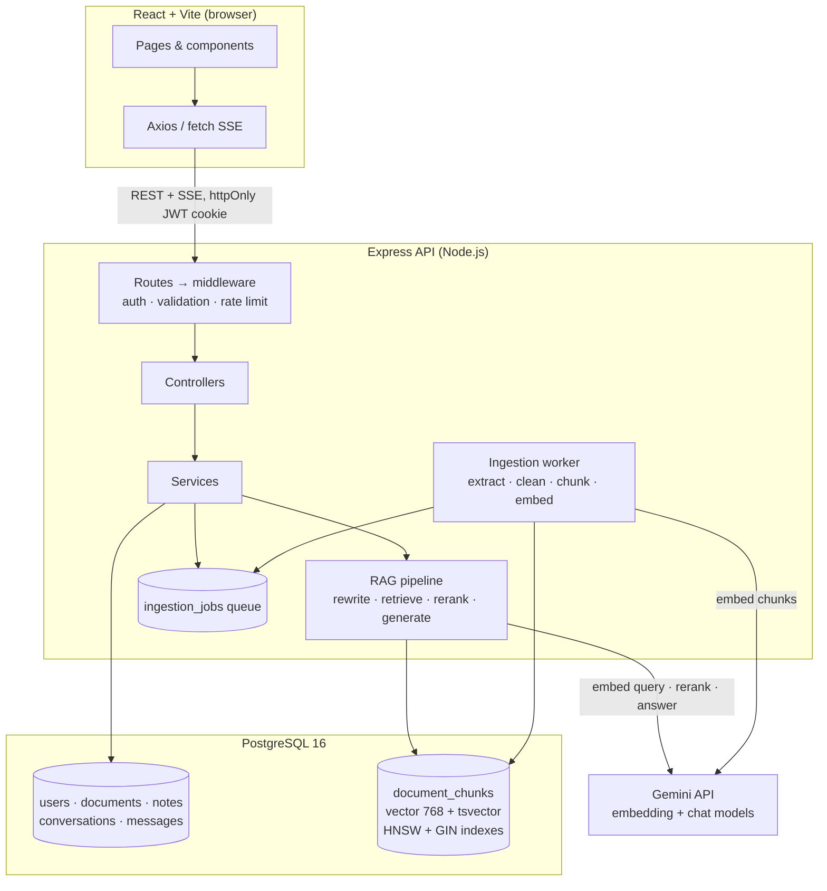

Simplified:

```text
React ──► Express API ──► Services ──► PostgreSQL ──► pgvector
                              │                          ▲
                              └──► RAG pipeline ─────────┘
                                       │
                                       ├──► Embedding model
                                       └──► LLM
```

### Project structure

```text
second-brain/
├── docker-compose.yml          # PostgreSQL 16 + pgvector
├── backend/
│   ├── src/
│   │   ├── config/             # env validation (zod), pg pool
│   │   ├── controllers/        # HTTP layer only — no business logic
│   │   ├── db/migrations/      # versioned SQL + tiny migration runner
│   │   ├── middleware/         # authenticateUser, validate, upload, rate limits, errors
│   │   ├── models/             # data-access layer — all SQL lives here, all user-scoped
│   │   ├── rag/
│   │   │   ├── extractors/     # pdf, text, markdown, transcript
│   │   │   ├── providers/      # gemini (REST) + mock (offline/tests)
│   │   │   ├── chunker.js      # structure-aware recursive chunker
│   │   │   ├── retriever.js    # hybrid search + RRF
│   │   │   ├── reranker.js     # LLM listwise reranker
│   │   │   ├── queryRewriter.js
│   │   │   ├── contextBuilder.js
│   │   │   ├── prompts.js
│   │   │   └── ragPipeline.js
│   │   ├── routes/
│   │   ├── services/           # auth, documents, notes, chat, search, stats, graph, ingestion
│   │   ├── validators/         # zod schemas
│   │   ├── workers/            # background ingestion worker
│   │   ├── app.js
│   │   └── server.js
│   └── tests/                  # node:test — unit + integration (real Postgres)
└── frontend/
    └── src/
        ├── components/         # ui/ primitives, chat/, graph, upload, editor…
        ├── context/            # AuthContext, ThemeContext
        ├── hooks/              # useAsync, usePolling, useDebounce…
        ├── layouts/            # AppLayout (sidebar), AuthLayout
        ├── pages/              # Dashboard, Chat, Knowledge, Document, Notes, Search, Settings
        ├── services/           # API clients + SSE stream parser
        └── utils/
```

---

## Tech stack

| Layer | Technology |
|---|---|
| Frontend | React 19, Vite, React Router, Tailwind CSS v4, Axios, react-markdown + remark-gfm + highlight.js, lucide-react, sonner, d3-force |
| Backend | Node.js 22+, Express 5 (ES modules), zod, jsonwebtoken, bcryptjs, multer, helmet, express-rate-limit |
| Database | PostgreSQL 16 + **pgvector** (HNSW index, cosine distance) + built-in full-text search |
| AI | Google Gemini — `gemini-embedding-2` (768-dim), `gemini-3.5-flash` (answers), `gemini-3.5-flash-lite` (rewrite/rerank/titles) |
| Documents | unpdf (pdf.js) for PDFs; custom Markdown / WebVTT / SRT parsers |
| Testing | `node:test`, supertest, Playwright (UI walkthrough) |

---

## System design

### Request flow

1. **Auth** — `authenticateUser` reads the JWT from the httpOnly cookie (or `Authorization: Bearer`), verifies signature/issuer/expiry, loads the user and attaches `req.user`. Deleted accounts are rejected immediately.
2. **Validation** — `validate({ body, params, query })` parses input with zod; controllers only read `req.validated`.
3. **Controllers → services → models** — controllers translate HTTP; services hold business rules; models hold SQL. Every model function that touches user data takes `userId` and puts it in the `WHERE` clause.
4. **Errors** — services throw `AppError`s (400/401/404/409/413/422/502). The central handler maps library and Postgres errors (e.g. `23505 → 409`, Multer `LIMIT_FILE_SIZE → 413`) and hides internal messages for anything unexpected.

Every response uses the same envelope:

```json
{ "success": true,  "data": { ... }, "meta": { "total": 24, "limit": 50, "offset": 0 } }
{ "success": false, "error": { "code": "NOT_FOUND", "message": "Document not found" } }
```

### Background ingestion

Uploads return **`202 Accepted`** as soon as the file is stored. A row in `ingestion_jobs` is created in the same transaction as the document, so a job can never be lost. Workers claim jobs with:

```sql
UPDATE ingestion_jobs SET status = 'running', attempts = attempts + 1, locked_at = now()
 WHERE id = (SELECT id FROM ingestion_jobs
              WHERE status = 'pending' AND run_after <= now()
              ORDER BY run_after FOR UPDATE SKIP LOCKED LIMIT 1)
RETURNING ...;
```

`SKIP LOCKED` lets several workers (or several API replicas) share the queue with no double-processing and no Redis. Transient failures (e.g. AI rate limits) retry with exponential backoff; content errors (empty/scanned/corrupt files) fail immediately with a useful message. Jobs left `running` by a crash are re-queued at startup.

### Tenant isolation

```text
User A ──► can ONLY retrieve User A's documents
User B ──► can ONLY retrieve User B's documents
```

- `document_chunks.user_id` is denormalised so **every** retrieval query filters by owner without a join — including both branches of hybrid search and the final join.
- Resource lookups use `WHERE id = $1 AND user_id = $2`; a foreign id is indistinguishable from a missing one (`404`), so ids can't be probed.
- Client-supplied filters (e.g. `documentIds`) are *added* to the user filter, never substituted for it.
- The integration suite has a dedicated **tenant-isolation** section proving that user B cannot read, list, search, chat over, modify or delete user A's data.

---

## The RAG pipeline

```text
                         INGESTION (once per document)
 file ─► extract ─► clean ─► chunk ─► embed (title + section header) ─► PostgreSQL + pgvector

                         QUERY (every question)
 question
   │  1. conversation-aware rewrite   "Why is it secure?" → "Why is JWT authentication secure?"
   ▼
 embed query (task-specific prompt)
   │  2. hybrid retrieval  ─ vector top-N (cosine, HNSW) ─┐
   │                       ─ keyword top-N (tsvector)    ─┴─► Reciprocal Rank Fusion
   ▼
 24 candidates ── 3. LLM rerank (0–10 relevance, drop < 3) ──► top K (6)
   │
   │  4. context builder: numbered passages [1]..[K] within a token budget
   ▼
 5. grounded prompt ──► LLM (streamed over SSE)
   │
   ▼
 answer with [n] citations ──► 6. map citations → sources (doc, page, section, chunk, excerpt)
```

**1. Extraction & cleaning** (`rag/extractors`, `rag/textCleaner.js`) — PDFs are read page by page so page numbers survive into citations. Running headers/footers (lines repeated on ≥60% of pages) and bare page numbers are stripped; hard-wrapped lines are re-flowed into paragraphs.

**2. Chunking** (`rag/chunker.js`) — a structure-aware recursive splitter: segments → paragraphs → sentences → words, splitting only as finely as needed to fit `CHUNK_SIZE` (default 1000 chars). Consecutive chunks share `CHUNK_OVERLAP` characters of *whole sentences*. Chunks never cross Markdown/transcript sections, but may flow across PDF pages (recorded as `page_number..page_end`).

**3. Embeddings** (`services/ingestionService.js`) — each chunk is embedded once at ingestion with a *contextual header* (source title, section, note tags) so that a passage like "it expires after 15 minutes" still lands near queries about JWT. Vectors are L2-normalised and stored in `vector(768)`.

**4. Hybrid retrieval** (`rag/retriever.js`) — semantic search catches paraphrases; keyword search catches exact terms, acronyms and names that embeddings blur. Results are fused with RRF, `score = Σ 1/(60 + rank)`, which needs no score normalisation between the two scales.

```sql
-- semantic branch (simplified)
SELECT id, 1 - (embedding <=> $query_vector) AS similarity
  FROM document_chunks
 WHERE user_id = $user_id
 ORDER BY embedding <=> $query_vector
 LIMIT 24;
```

**5. Reranking** (`rag/reranker.js`) — one batched call to the fast model scores every candidate 0–10 against the query (a listwise LLM reranker). This is far more precise than embedding similarity and lets the system drop noise entirely, which is what makes honest "not found" answers possible. Falls back to RRF order on any failure.

**6. Prompting** (`rag/prompts.js`) — the model is instructed to answer **only** from the numbered passages, cite every claim as `[n]`, say *"I couldn't find this in your knowledge base"* when appropriate, flag partial answers, put any outside knowledge in a separate **"Beyond your notes"** section, and treat passages as data (prompt-injection guard).

**7. Citations** (`rag/contextBuilder.js`) — the citation list is built from the same numbering as the prompt, so `[2]` always maps to a concrete `{ documentId, chunkId, pageNumber, section, excerpt }`. The answer is scanned for markers; cited sources are flagged and shown first.

Each assistant message stores retrieval metadata (rewritten query, candidate counts, per-stage timings, model), visible via the ⓘ button under every answer.

### Offline mock provider

Set `AI_PROVIDER=mock` to run the whole app with no API key. Embeddings are deterministic hashed bag-of-words vectors (texts sharing vocabulary really are close in cosine space) and answers are extractive with real citations. The test-suite uses it, and it's handy for demos.

---

## Database schema

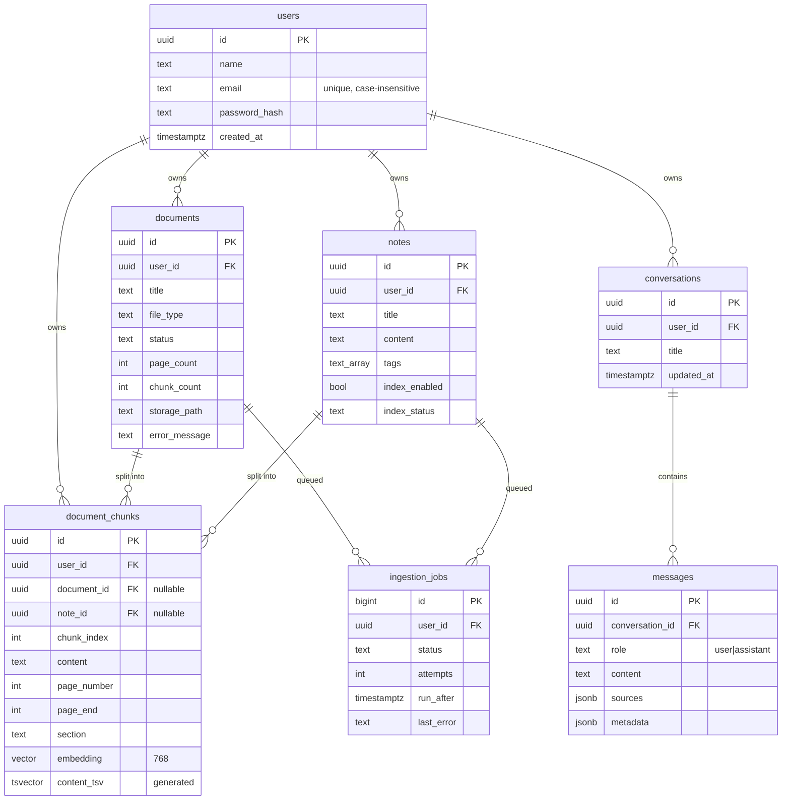

Key indexes (see [`001_initial_schema.sql`](backend/src/db/migrations/001_initial_schema.sql)):

| Index | Purpose |
|---|---|
| `HNSW (embedding vector_cosine_ops)` | approximate nearest-neighbour search |
| `GIN (content_tsv)` | full-text keyword search |
| `(user_id)` on chunks | tenant filter for every retrieval |
| `(user_id, created_at DESC)` on documents, `(user_id, updated_at DESC)` on notes/conversations | dashboard & list pages |
| partial `(run_after) WHERE status='pending'` | cheap job polling |
| `UNIQUE (lower(email))` | case-insensitive accounts |

All foreign keys use `ON DELETE CASCADE`: deleting a document removes its chunks, embeddings and jobs; deleting an account removes everything.

---

## API documentation

All routes are prefixed with `/api`. Everything except `auth/register`, `auth/login`, `auth/logout` and `health` requires authentication.

### Auth

| Method | Route | Body | Description |
|---|---|---|---|
| POST | `/auth/register` | `{ name, email, password }` | Create account, sets auth cookie → `201` |
| POST | `/auth/login` | `{ email, password }` | Log in, sets auth cookie |
| POST | `/auth/logout` | — | Clear cookie |
| GET | `/auth/me` | — | Current user |
| PATCH | `/auth/me` | `{ name }` | Update profile |
| PUT | `/auth/password` | `{ currentPassword, newPassword }` | Change password |
| DELETE | `/auth/me` | `{ password }` | Delete account and all data |

### Documents

| Method | Route | Description |
|---|---|---|
| GET | `/documents?status=&q=&limit=&offset=` | List documents |
| POST | `/documents/upload` | `multipart/form-data`, field `files` (1–10) → `202` |
| GET | `/documents/:id?limit=&offset=` | Document + its chunks |
| GET | `/documents/:id/file` | Original file (owner only) |
| PATCH | `/documents/:id` | `{ title }` rename |
| POST | `/documents/:id/reprocess` | Re-queue a failed document → `202` |
| DELETE | `/documents/:id` | Delete document, chunks, embeddings and file |

### Notes

| Method | Route | Description |
|---|---|---|
| GET | `/notes?q=&tag=` | List notes |
| GET | `/notes/tags` | Tag cloud with counts |
| POST | `/notes` | `{ title, content, tags[], indexEnabled }` → `201` |
| GET | `/notes/:id` | Get note |
| PUT | `/notes/:id` | Partial update (re-indexes) |
| DELETE | `/notes/:id` | Delete note and its chunks |

### Conversations & chat

| Method | Route | Description |
|---|---|---|
| GET | `/conversations` | List conversations |
| POST | `/conversations` | `{ title? }` create |
| GET | `/conversations/:id` | Conversation + messages |
| PATCH | `/conversations/:id` | `{ title }` rename |
| DELETE | `/conversations/:id` | Delete |
| POST | `/chat` | `{ message, conversationId?, filters? }` — see below |

`POST /chat` returns JSON by default. With `Accept: text/event-stream` it streams:

```text
event: meta     data: { conversation, userMessage }
event: sources  data: { sources: [...], standaloneQuery }
event: token    data: { text: "partial answer…" }        (repeated)
event: done     data: { conversation, userMessage, assistantMessage }
event: error    data: { code, message }                   (on failure)
```

`filters`: `{ sourceType: "all" | "documents" | "notes", documentIds?: uuid[] }`.

### Search, stats, graph

| Method | Route | Description |
|---|---|---|
| POST | `/search` | `{ query, mode: hybrid\|semantic\|keyword, sourceType, limit }` |
| GET | `/chunks/:id` | A single source passage (for citations) |
| GET | `/stats` | Dashboard counts + recent items |
| GET | `/graph` | Knowledge-graph nodes and edges |
| GET | `/health` | Liveness probe |

Example:

```bash
curl -X POST http://localhost:5000/api/search \
  -H "Authorization: Bearer $TOKEN" -H "Content-Type: application/json" \
  -d '{"query":"refresh token security","mode":"hybrid"}'
```

Status codes: `400` invalid input · `401` unauthenticated · `404` not found / not yours · `409` conflict · `413` file too large · `422` unsupported or unprocessable file · `429` rate limited · `502` AI service error · `500` unexpected.

---

## Environment variables

Copy `backend/.env.example` to `backend/.env`. The server validates everything at startup and exits with a clear message if something is wrong.

| Variable | Default | Description |
|---|---|---|
| `DATABASE_URL` | — | PostgreSQL connection string (**required**) |
| `JWT_SECRET` | — | ≥ 32 random characters (**required**) |
| `AI_PROVIDER` | `gemini` | `gemini` or `mock` (offline, no key) |
| `GEMINI_API_KEY` | — | Required for `gemini` — free at [aistudio.google.com/apikey](https://aistudio.google.com/apikey) |
| `GEMINI_CHAT_MODEL` | `gemini-3.5-flash` | Model that writes answers |
| `GEMINI_FAST_MODEL` | `gemini-3.5-flash-lite` | Model for rewrite / rerank / titles |
| `GEMINI_EMBEDDING_MODEL` | `gemini-embedding-2` | Embedding model (`gemini-embedding-001` also supported) |
| `EMBEDDING_DIMENSIONS` | `768` | Must match `vector(768)` in the migration |
| `PORT` | `5000` | API port |
| `CLIENT_ORIGIN` | `http://localhost:5173` | CORS allow-list (comma-separated) |
| `JWT_EXPIRES_IN` | `7d` | Session length |
| `COOKIE_SECURE` | `false` | Set `true` behind HTTPS |
| `MAX_UPLOAD_MB` | `20` | Per-file upload limit |
| `CHUNK_SIZE` / `CHUNK_OVERLAP` | `1000` / `150` | Chunker settings (characters) |
| `RAG_TOP_K` | `6` | Passages sent to the LLM |
| `RAG_CANDIDATES` | `24` | Hybrid-search candidates before reranking |
| `RAG_MIN_SIMILARITY` | `0.3` | Minimum cosine similarity for a semantic match |
| `RAG_RERANK` / `RAG_QUERY_REWRITE` | `true` | Toggle pipeline stages |
| `RAG_HISTORY_MESSAGES` | `6` | Prior messages used for follow-ups |
| `WORKER_ENABLED` / `WORKER_CONCURRENCY` | `true` / `2` | Background ingestion |
| `DB_AUTO_MIGRATE` | `true` | Apply migrations on startup |

The frontend needs no environment variables — in development Vite proxies `/api` to the backend.

---

## Installation & running locally

**Prerequisites:** Node.js 22+, Docker Desktop (or your own PostgreSQL 15+ with pgvector), and a free Gemini API key (optional — use `AI_PROVIDER=mock` without one).

```bash
# 1. Install dependencies (root, backend, frontend)
npm run install:all

# 2. Start PostgreSQL + pgvector (host port 5433)
npm run db:up

# 3. Configure the backend
cp backend/.env.example backend/.env        # Windows: copy backend\.env.example backend\.env
#    → set JWT_SECRET and GEMINI_API_KEY (or AI_PROVIDER=mock)
#    Generate a secret: node -e "console.log(require('crypto').randomBytes(48).toString('hex'))"

# 4. Run API + web app together (migrations run automatically)
npm run dev
```

Open **http://localhost:5173**, create an account, upload a document and start asking questions.

| Command | What it does |
|---|---|
| `npm run dev` | API on :5000 + Vite on :5173 |
| `npm run migrate` | Apply database migrations manually |
| `npm test` | Backend unit + integration tests |
| `npm run build` | Production build of the frontend |
| `npm run db:down` | Stop the database (`docker compose down -v` wipes data) |

**Production:** `npm run build`, then run the backend with `NODE_ENV=production` — Express serves `frontend/dist` from the same origin. Set `COOKIE_SECURE=true` behind HTTPS.

---

## Testing

```bash
npm test
```

55 tests run against a **real PostgreSQL + pgvector** database (`second_brain_test`, created automatically by Docker Compose) using the deterministic mock AI provider:

- **Unit** — chunker (size limits, sentence boundaries, overlap, sections, page ranges), extractors (PDF pages, Markdown headings, VTT timestamps/speakers, transcript detection, binary rejection), keyword-query sanitising, citation parsing, and the Gemini adapter against a stubbed `fetch` (request format, SSE parsing across chunk boundaries, error mapping).
- **Integration** — registration/login/cookies, bcrypt storage, uploads → background indexing → chunks with page numbers and 768-dim vectors, unsupported/fake/oversized files (`422`/`413`), notes indexing, hybrid search, JSON + SSE chat with citations, follow-up rewriting, honest "not found", stats, graph, cascade deletion, and a full **tenant-isolation** suite.

---

## Example queries

After uploading lecture notes and docs, try:

- *"Explain JWT refresh tokens"* → answer citing `Backend Notes.pdf — page 2`
- *"Why is it secure?"* (follow-up) → rewritten to *"Why are JWT refresh tokens secure?"*
- *"What did the professor say about cosine distance?"* → cites `Lecture 12 — at 00:02:10`
- *"Compare sessions and token-based auth"* → combines passages from several documents
- *"Create a 5-question quiz from my database notes"*
- *"What's the capital of Mongolia?"* → *"I couldn't find this in your knowledge base."*

---

## Screenshots

| Dashboard | Knowledge library |
|---|---|
| 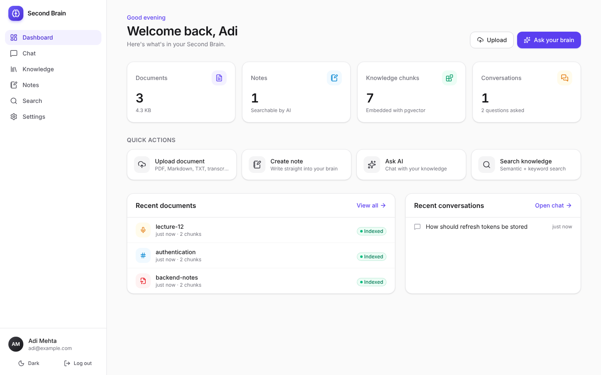 | 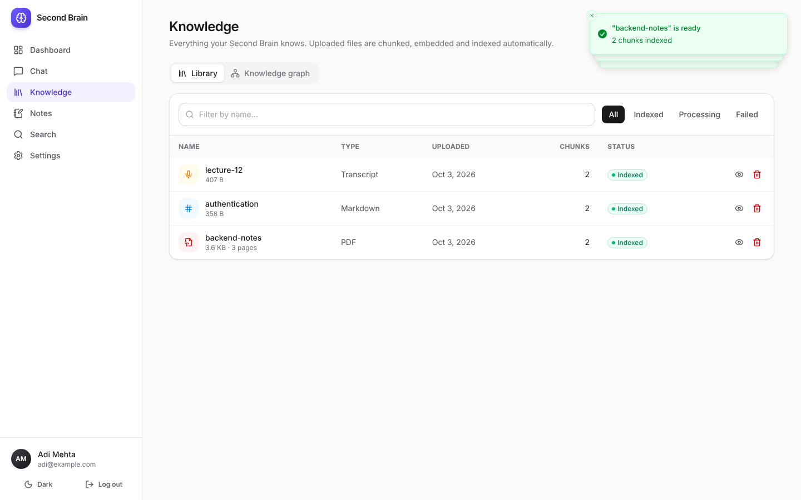 |

| Citation drawer | Hybrid search |
|---|---|
| 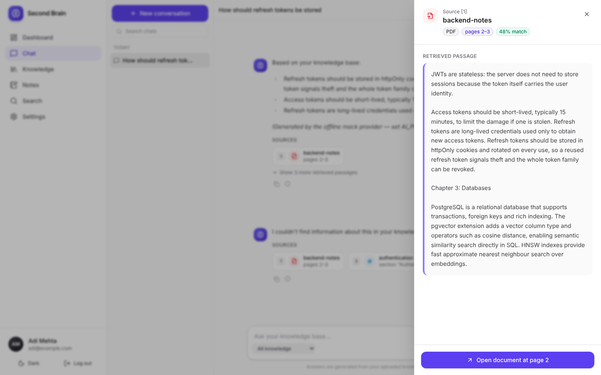 | 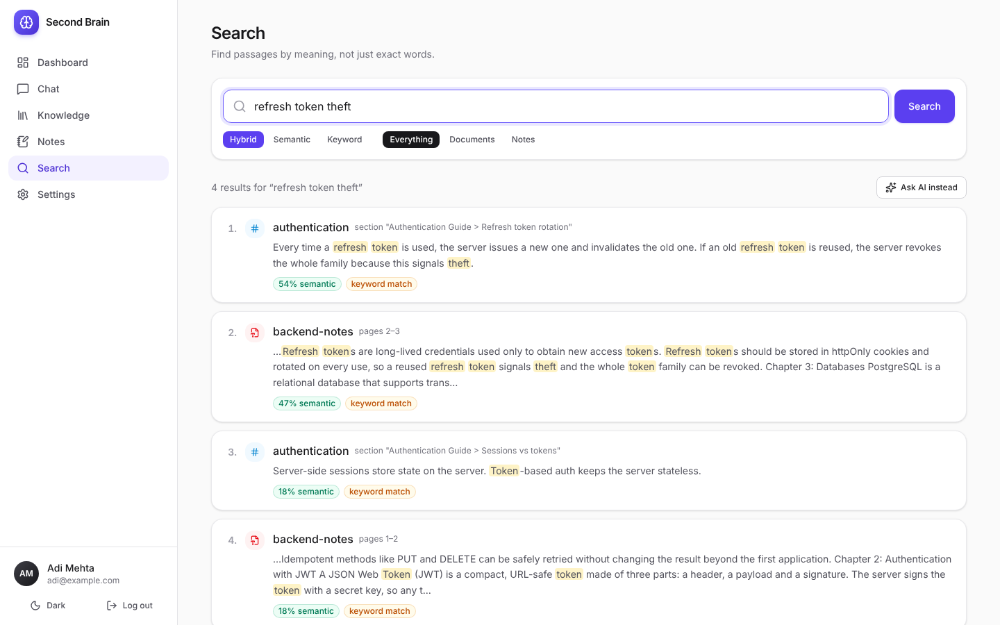 |

| Notes | Knowledge graph |
|---|---|
| 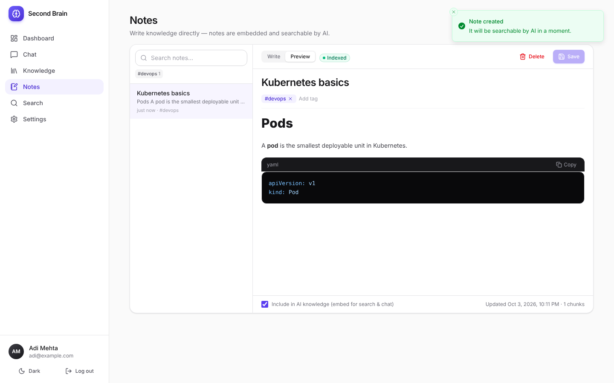 | 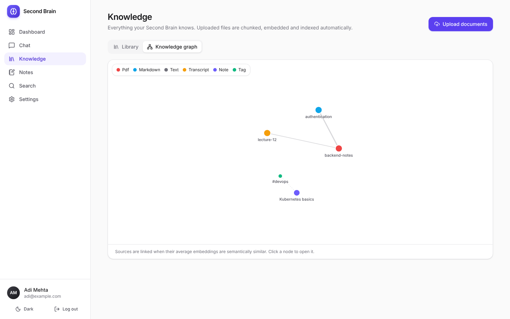 |

| Dark mode | Mobile |
|---|---|
| 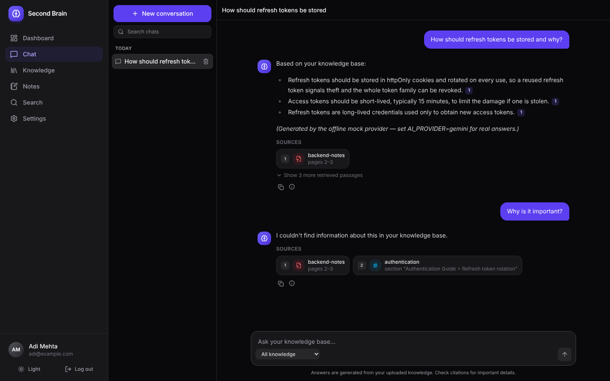 | 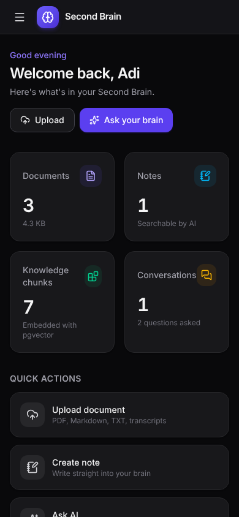 |

> Screenshots were captured with the offline mock provider; with Gemini enabled, answers are full natural-language responses.

---

## Future improvements

- OCR for scanned PDFs (Tesseract) and DOCX / HTML / web-page ingestion
- Dedicated cross-encoder reranker (e.g. a hosted rerank model) to cut LLM cost
- Refresh-token rotation with a server-side session table for instant revocation
- Semantic chunking (split where embedding similarity between sentences drops)
- Per-document access sharing and team workspaces (row-level security in Postgres)
- Evaluation harness (retrieval recall@k, answer faithfulness) with a golden Q&A set
- Swap the in-process worker for a separate worker container; object storage (S3) for files
- More providers (OpenAI, Ollama) behind the existing `ai` interface
- `pgvector` ≥ 0.8 iterative index scans for very large multi-tenant tables

---

Built as a final-year full-stack / AI engineering portfolio project.
